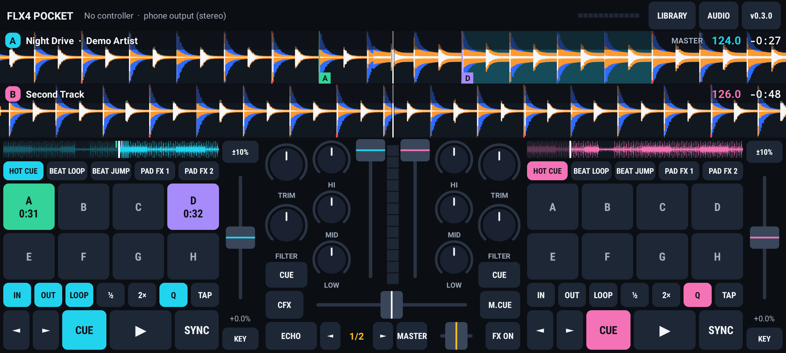

# FLX4 Pocket

[](https://github.com/stxtxm/flx4-pocket/actions/workflows/ci.yml)
[](https://github.com/stxtxm/flx4-pocket/releases/latest)

A two-deck Android DJ app built around the **Pioneer DJ DDJ-FLX4**. Plug the
controller in and it follows the FLX4's official MIDI map; leave it at home and
the whole mixer is on the touch screen: scrolling waveforms, pads, EQ, filter,
Beat FX and a crossfader.



*Rendered from the real layout by the test suite, with two synthetic tracks.*

Built for a **Pixel 9a** first, compatible with Android 8.0+ (API 26).

> **Status: not yet verified on hardware.** Everything here is covered by JVM
> tests (DSP, deck logic, the MIDI address table, the real screen under
> Robolectric), but no phone or controller was available where 0.3.0 was
> built. See [docs/TESTING.md](docs/TESTING.md) for what must be checked on a
> device, and [docs/ANDROID-LIMITS.md](docs/ANDROID-LIMITS.md) for what Android
> itself may refuse (controller power, four-channel USB audio).

## What is in 0.3.0

**Mixing from the phone**

- Two stacked, scrolling three-band waveforms (bass / mids / highs) with the
  beat grid, loop region, cue point and hot cues. Drag a waveform to scratch or
  position the track, pinch to zoom; both decks share the zoom so their beats
  can be lined up by eye.
- Track overview per deck with needle search.
- Eight pads per deck in five modes: Hot Cue, Beat Loop, Beat Jump, Pad FX 1
  (echoes and slip loop rolls) and Pad FX 2 (low-cut echo, reverb, flanger,
  phaser, trans).
- CDJ-style CUE (hold to preview), PLAY, SYNC (long press: sync master),
  pitch-bend buttons, tempo fader with ±6 / ±10 / ±16 % / WIDE ranges, TAP.
- KEY (keylock): the tempo changes, the pitch does not (WSOLA time-stretch).
- A synced deck follows the master's tempo when it moves.
- Loop IN / OUT / RELOOP, halve / double, quantize.
- Mixer: trim, three-band EQ (-26 / +6 dB, like a DJM), filter, channel faders
  with level meters, equal-power crossfader, headphone cue buttons, master
  peak limiter. Faders are ramped (no zipper noise) and pitched audio uses
  cubic interpolation.
- Beat FX on deck A, deck B or the master: echo, low-cut echo, reverb,
  flanger, phaser, trans, with beat length and depth.
- Smart CFX: the filter knob becomes a resonant sweep with a synced echo.
- Searchable library over a music folder (no storage permission), hot cues and
  analysis remembered per track. Tap an empty deck (or its PLAY) to open the
  library for that deck, then tap a track to load it there. The library opens
  under the waveforms, so the playing deck and its remaining time stay in
  sight.
- A deck that is playing refuses a new track (load lock): pause it first.
- A few seconds after loading, the whole track is in memory, so hot cues,
  loops and jumps play at once, with a short crossfade instead of a click.
- The mix keeps playing with the screen off or another app in front; a
  notification shows while it does.

**With the DDJ-FLX4**

- On connection the app sends the controller's keep-alive (from the Mixxx
  mapping), which the FLX4 answers with the position of every fader and knob:
  the mixer starts where the hardware is.
- The official MIDI addresses for transport, jog (scratch / bend / search),
  tempo, mixer, filter, Smart CFX, Beat FX, loop section, browse / load and
  the performance pads, with LED feedback and the channel level meters.
- The controller's sound card is selected automatically when Android exposes
  it. With four output channels the master goes to 1-2 (MASTER out) and the
  headphone bus to 3-4 (PHONES), with CUE buttons, headphones mix and level
  working as on the hardware. If Android only offers stereo, the app falls back
  to stereo or to split cue.

**Updates**

- The version button in the top bar checks GitHub Releases in the background,
  downloads with progress on the button while you keep mixing, and installs
  only when you tap INSTALL. Every APK is checked (SHA-256, package, version,
  signing certificate) before Android's installer is opened.

## Not here yet

- Sampler, Keyboard / Stems and Key Shift pad modes, Smart Fader.
- Streaming services, recording, DVS.

## Install (first time)

1. Download `FLX4-Pocket-<version>.apk` from
   [Releases](https://github.com/stxtxm/flx4-pocket/releases/latest).
2. Either open it on the phone and allow installation from that source, or:
   ```bash
   adb install -r FLX4-Pocket-0.3.0.apk
   ```
3. Open FLX4 Pocket, tap **FOLDER** in the library and pick your music
   folder. Tap an empty deck, then a track, to load it there; **DECK A** and
   **DECK B** on each track load it on either deck.
4. Optional: connect the DDJ-FLX4. Power it through its **power** USB-C port
   (5 V adapter or power bank) and connect the phone to its **device** USB-C
   port. The status line turns green and shows which output is in use. Turn
   the phone's media volume all the way up: Android scales the USB output by
   it. Set the level with the FLX4's MASTER LEVEL knob.
5. **AUDIO** lists the outputs and holds the master / headphones levels. On a
   stereo-only output, **Split cue** sends the master left and the headphones
   right for a splitter cable.

Pioneer documents the separate power port for phones; a phone's USB port is
not guaranteed to power the controller.

### Do not open the APK on Fedora/GNOME

If double-clicking the APK in GNOME Files starts GNOME Software/PackageKit and
shows an authentication error ("Mise à jour impossible… groupe wheel / mot de
passe root"), that is the Linux package manager trying to install an **Android**
package as if it were an RPM. It is unrelated to FLX4 Pocket and cannot succeed.

Copy the APK to the Pixel and open it there, or install it from this repository
with adb:

```bash
adb install -r FLX4-Pocket-0.3.0.apk
```

## Controller workflow

| FLX4 control | App action |
| --- | --- |
| PLAY / PAUSE | Play / pause; on an empty deck, open the library for it |
| CUE | CDJ cue: set, preview while held, back to cue when playing |
| SHIFT + CUE | Back to the start of the track |
| BEAT SYNC / long press | Sync to the other deck / make this deck the master |
| SHIFT + BEAT SYNC | Cycle the tempo range |
| Tempo fader | Pitch, 14-bit, across the selected range. Soft takeover: after a sync, a touch change or a reconnection it takes over once it reaches the playing speed; until then an arrow next to the pitch shows which way to move it |
| Jog top (touch) / side | Scratch / pitch bend |
| SHIFT + jog | Fast search |
| TRIM, EQ, channel fader, crossfader | Mixer |
| CFX knob / SMART CFX | Filter / resonant filter + echo |
| Headphones CUE, MASTER CUE, mix, level | Headphone bus |
| MASTER LEVEL | Master gain |
| BEAT FX select, beat ◄ ►, CH select, level/depth, ON/OFF | Beat FX |
| IN / OUT / RELOOP-EXIT | Manual loop; hold IN for a 4-beat loop |
| CUE/LOOP CALL ◄ ► | Halve / double the loop; with SHIFT jump 16 beats |
| HOT CUE, PAD FX1/2, BEAT JUMP, BEAT LOOP + pads | Pad modes |
| SHIFT + hot-cue pad | Delete the hot cue |
| Browse turn / press | Library selection (the first turn only opens it) / open, close |
| LOAD 1 / 2 | Load the selected track and close the library; with the library closed, open it for that deck first |
| SHIFT + channel CUE | Toggle quantize |

The complete address table is in [docs/DDJ-FLX4-MIDI.md](docs/DDJ-FLX4-MIDI.md).

## Updates on the phone

Every release publishes `update.json`, the APK and its SHA-256 in GitHub
Releases. The app checks on launch and then hourly; a new version turns the
top-bar button amber. Tap it to read the notes and start the download, keep
mixing while the button counts up, and tap **INSTALL** when the music can
stop. Android always shows its own confirmation, and the first time it asks
to allow installs from FLX4 Pocket; the installation resumes by itself when
you come back from that setting. Updates must be signed with the same key as
the installed build. See [docs/RELEASES.md](docs/RELEASES.md).

## Build and test

Requirements: JDK 17, Android SDK platform 34 and build-tools 34.0.0.

```bash
./gradlew testDebugUnitTest
./gradlew assembleDebug
```

The debug APK is written to `app/build/outputs/apk/debug/app-debug.apk`.

Release signing (same env names used by CI):

```bash
export ANDROID_KEYSTORE_FILE="$PWD/keystore/release.jks"
export ANDROID_STORE_PASSWORD=...
export ANDROID_KEY_ALIAS=flx4-pocket
export ANDROID_KEY_PASSWORD=...
./gradlew assembleRelease
```

## Project layout

```
app/src/main/java/.../
  MainActivity.kt    screen wiring: touch + MIDI -> engine -> screen + LEDs
  DeckPanel.kt       touch controls of one deck
  WaveformView.kt    scrolling waveform and track overview
  Controls.kt        knob, fader and meter views
  AudioEngine.kt     shared-clock mixer, output routing, Beat FX
  Deck.kt            transport, sync, loops, cues, scratch, EQ, pad FX
  Fx.kt              echo, reverb, flanger, phaser, trans
  AudioSource.kt     streaming MediaCodec decoder + PcmRing
  PcmDecoder.kt      MediaCodec helpers, offline decode
  Waveform.kt        three-band waveform data, builder, cache file
  BpmAnalyzer.kt     onset autocorrelation
  Library.kt         folder scan, analysis cache, track analyzer
  Flx4Protocol.kt    MIDI bytes -> semantic events (pure, tested)
  Flx4Midi.kt        USB MIDI transport and LEDs
  MidiMap.kt         FLX4 addresses
  UpdateUi.kt / UpdateChecker.kt / UpdateInstaller.kt   in-app updates
docs/                mapping, limits, architecture, testing, releases
.github/workflows/   CI and release pipeline
```

More: [architecture](docs/ARCHITECTURE.md), [testing](docs/TESTING.md).

## License

No license file has been added yet. All rights reserved by the author until a
license is chosen.
